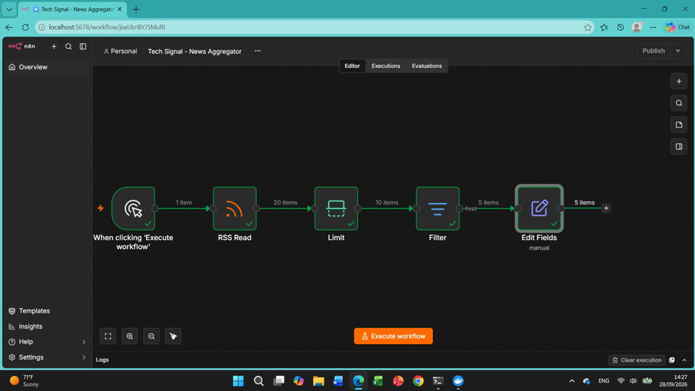

# Tech Signal — News Aggregator

An n8n workflow that pulls recent AI news from an RSS feed, keeps a small topic-focused set of items, and reshapes them into a consistent record.

**Week 6 In-Class Activity** · Individual submission

## Overview

| | |
|---|---|
| **Workflow name** | Tech Signal — News Aggregator |
| **Export file** | `news_aggregator.json` |
| **Source / site** | TechCrunch AI RSS |
| **Feed URL** | https://techcrunch.com/category/artificial-intelligence/feed/ |
| **Topic** | AI |
| **Feed choice** | Retained the class-default TechCrunch AI RSS feed (no custom feed swap) |
| **Trigger** | Manual (run from the n8n editor) |

The workflow follows the low-code loop **trigger → retrieve → filter → transform**.

## How it works

```
Manual Trigger → RSS Read → Limit → Filter → Edit Fields
```

### Nodes in execution order

1. **When clicking 'Execute workflow'** (Manual Trigger): starts a run on demand while developing.
2. **RSS Read**: fetches the TechCrunch AI feed from the URL above.
3. **Limit**: keeps at most **10** items so the working set stays small and easy to inspect.
4. **Filter**: keeps an item if its **title contains "AI" or "agent"** (case-insensitive, OR logic).
5. **Edit Fields**: maps the publisher's RSS fields into one consistent record (see below).

### Output fields (Edit Fields)

| Output field | Source | Notes |
|---|---|---|
| `title` | `$json.title` | Original headline |
| `summary` | `$json.contentSnippet` | Short feed description |
| `pubDate` | `$json.pubDate` | Feed publication time |
| `categories` | `$json.categories` | Array of feed categories |
| `source` | Fixed text: `TechCrunch AI RSS` | Change if the feed is swapped |
| `link` | `$json.guid` | Article URL |
| `collected_at` | `{{ $now.toISO() }}` | When n8n processed the item |

## Run it yourself

1. In n8n, choose **Import from File** and select `news_aggregator.json`.
2. Click **Execute workflow**.
3. Open the **Edit Fields** node and inspect its output to see the cleaned records.

## Evidence

**Successful full execution**



## Reflection

n8n made the plumbing easy. I didn't have to write code to fetch the feed, trim it to 10 items, filter by keyword, or reshape fields; each step was a node I could run and inspect. Seeing the actual output of every node made it simple to find the right field names instead of guessing. What I still had to decide and maintain myself was the logic: which keywords define "AI" news, which fields are worth keeping, and how my record format differs from the publisher's. If this ran daily for a semester, I would change the filter and limit. A 10-item cap could miss articles on busy news days, and a title-only keyword match would drift as terminology changes, so I would raise the limit, add a schedule trigger, and review the filter regularly.

