# Test evidence

Environment: n8n self-hosted in Docker at `http://localhost:5678`; GitHub CLI forwarding `issues` events to `/webhook/sprint2-issue-triage`; repository `NidhiMusale/n8n-sprint2-issue-triage`. All times are local, 2026-10-11. Each test used the exact title and body from the course tutorial.

## Summary
| # | Issue title | Execution | Expected | Observed |
| --- | --- | --- | --- | --- |
| 1 | Bug: blank screen after logout | #18, 20:45:47 | bug; `bug-triage`; ledger `recorded` | As expected |
| 2 | Feature request: export task list to CSV | #19, 20:53:48 | feature; `feature-requests`; `recorded` | As expected |
| 3 | Help: change the public webhook address | #25, 21:12:12 | help; `support`; `recorded` | As expected (see note) |
| 4 | Documentation: clarify local setup | #21, 20:57:07 | other; `general-triage`; `recorded` | As expected |
| Dup. | Replay of Test 1's original payload | #26, 21:33:30 | no second route-log row | As expected |
| Gate | Edit of Test 4's body | #27, 21:38:31 | stops at Opened action?, no new rows | As expected |
| 5 | Documentation: intentional route-log failure test | #28, 21:40:24 | other; ledger `failed`; no route-log row | As expected |

Final table state: `github_issue_ledger` has 5 rows (4 `recorded`, 1 `failed`); `github_issue_route_log` has 4 rows.

## Test 1: bug
Execution #18 went through **Set bug route** and the insert path. The ledger row is category `bug`, and the route log has one `bug-triage` row.

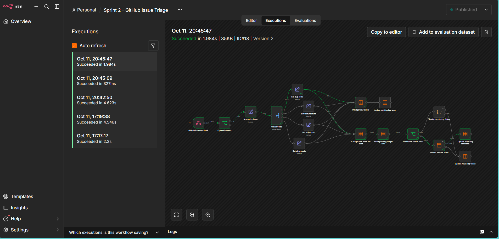
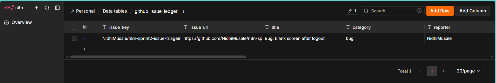
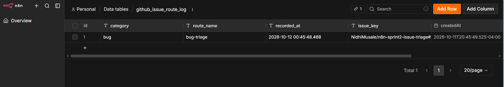

## Test 2: feature
Execution #19 went through **Set feature route**.

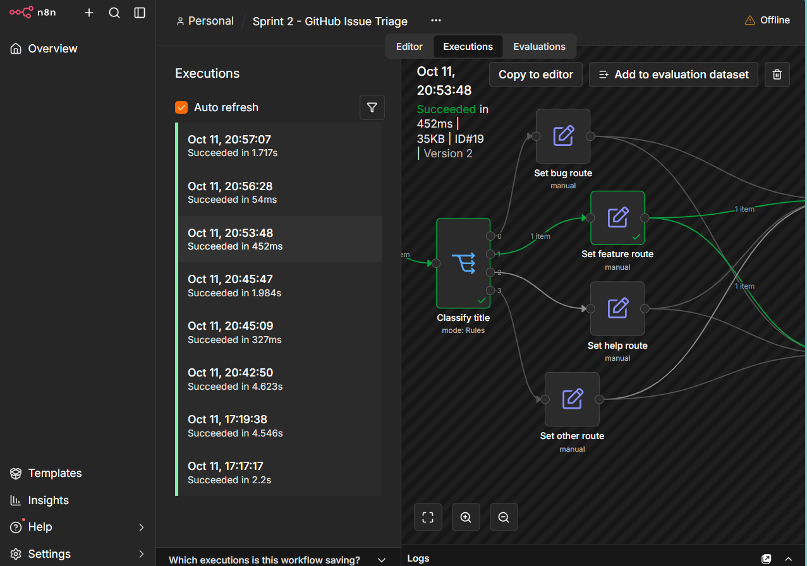

## Test 4: other (fallback)
The Documentation title matches none of the keywords, so it takes the fallback route. The tables after Test 4 show the ledger rows for the bug, feature, and documentation issues and the route-log rows `bug-triage`, `feature-requests`, and `general-triage`.

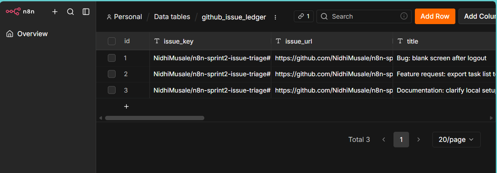
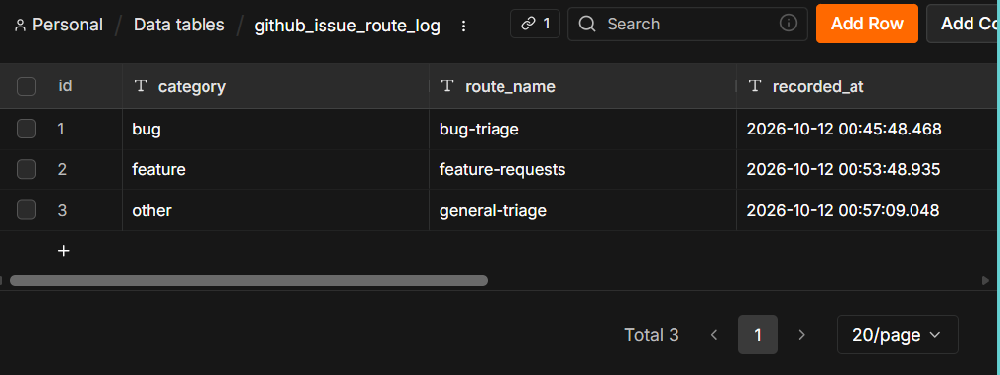

## Test 3: help
Execution #25 went through **Set help route** and the insert path. The route log gained a `help` / `support` row (visible in the next section's table).

Note: the first Help issues did not route, because Rule 3 of **Classify title** was set to "is equal to" instead of "matches regex", so no output matched. After correcting the operation and republishing, the Help issue was deleted and recreated; execution #25 is the successful run. The earlier stalled issues were deleted and left no ledger or route-log rows.

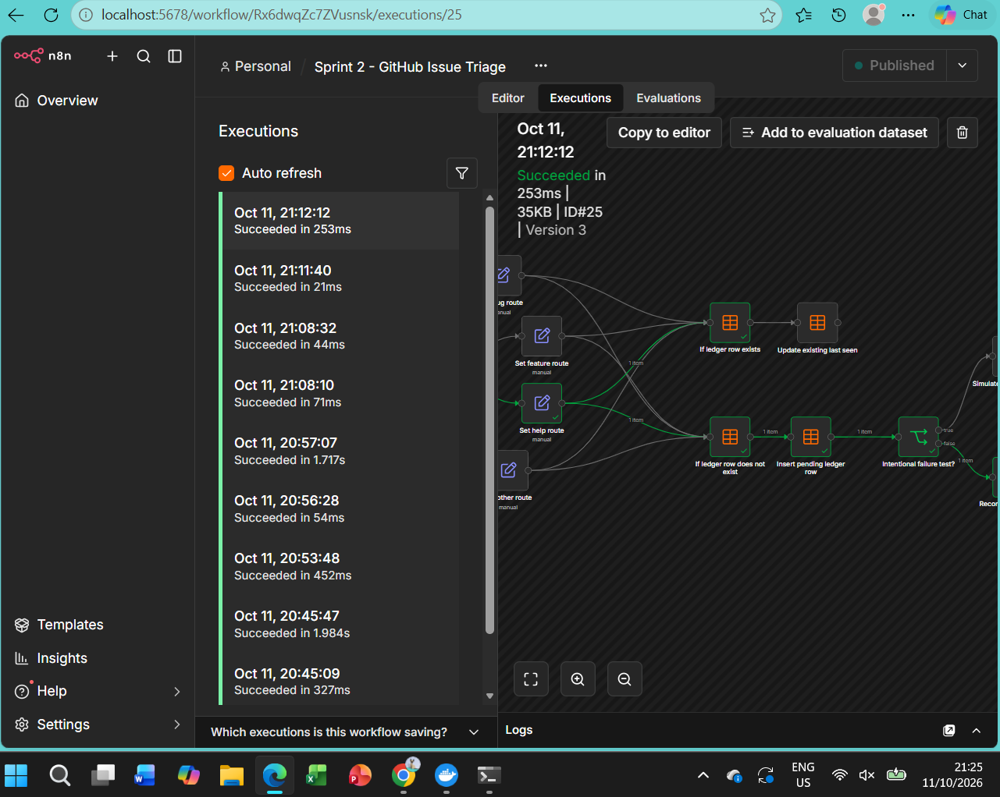

## Duplicate delivery (redelivery test)
**Before:** the route log showed Total 4 with exactly one `bug-triage` row.

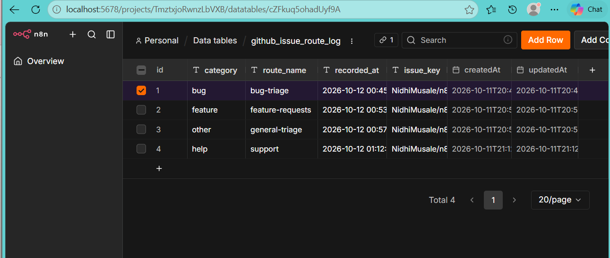

**GitHub's Redeliver attempt:** Test 1's original `issues.opened` delivery (GUID `43c6cdb6-c5d6-11f1-8ad4-54f985057e99`) is in GitHub's delivery list. Redelivering it failed twice (21:22:03 and 21:26:31) with **HTTP 401 Unauthorized** returned by the temporary CLI webhook, so the request never reached n8n.

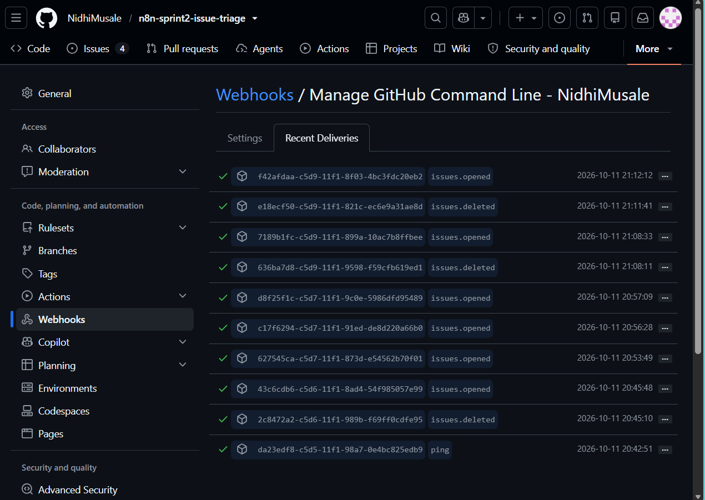
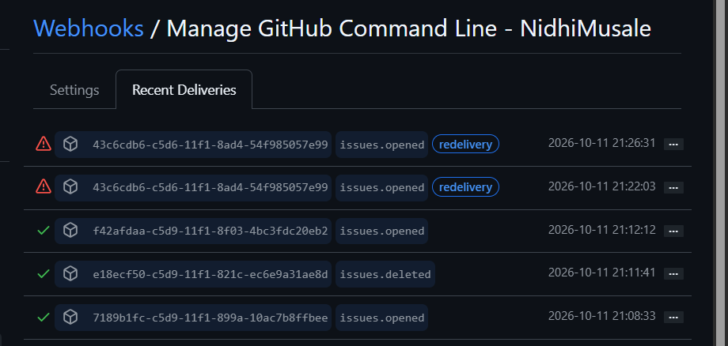
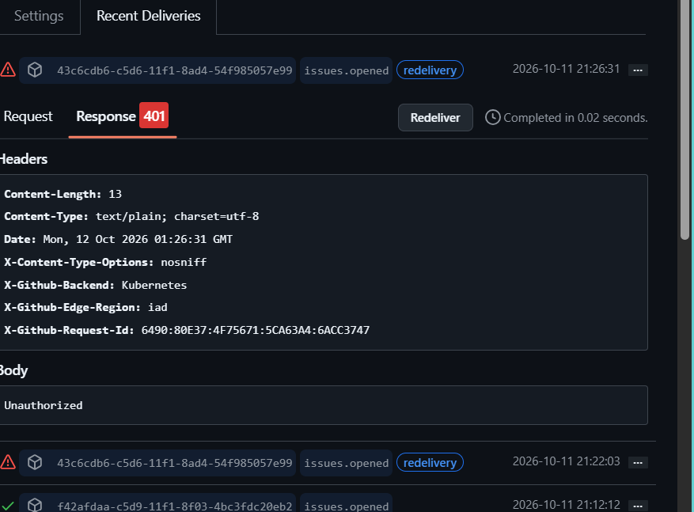

**Substitute:** the original Test 1 payload was copied from GitHub's delivery page and posted to the same local URL with `curl.exe -X POST -H "Content-Type: application/json" -H "X-GitHub-Event: issues" --data-binary "@payload.json" http://localhost:5678/webhook/sprint2-issue-triage`. n8n answered `{"message":"Workflow was started"}`.

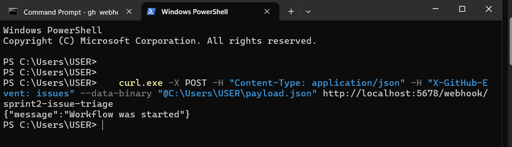

**Result:** execution #26 passed through **If ledger row exists** and **Update existing last seen**; **Insert pending ledger row** did not run. The route log still has no second `bug-triage` row (see the final route-log table below, Total 4).

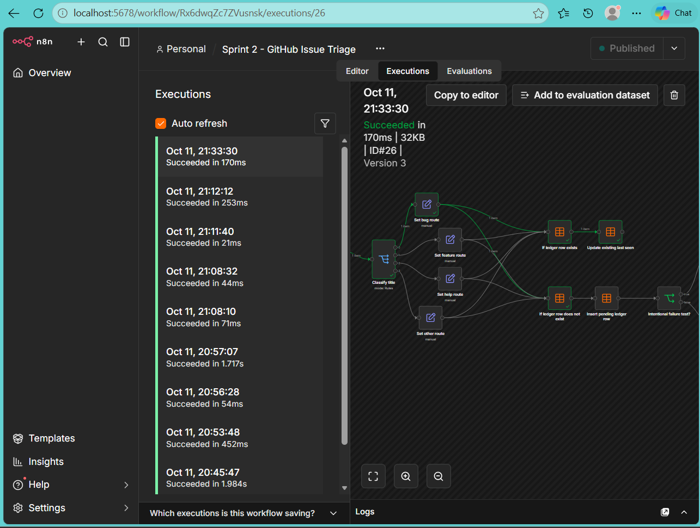

*Disclosure: this was a local replay of the identical payload, not GitHub's Redeliver button.*

## Opened-action gate
Appended "Edited only to test that non-opened issue actions do not enter triage." to Test 4's body. Execution #27 ran 27 ms and stopped at **Opened action?**; both tables stayed at their previous counts (ledger 4, route log 4 at that time).

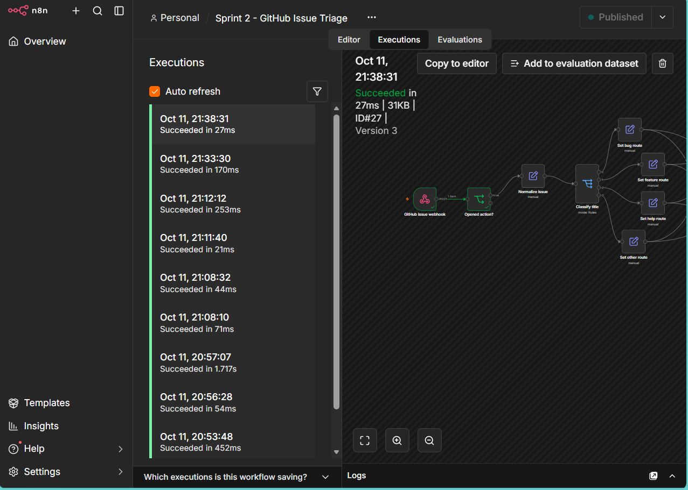

## Test 5: failed route-log write
Created "Documentation: intentional route-log failure test". Execution #28 went **Intentional failure test?** (true) to **Simulate route-log failure**, then through its error output to **Update route-log failed**.

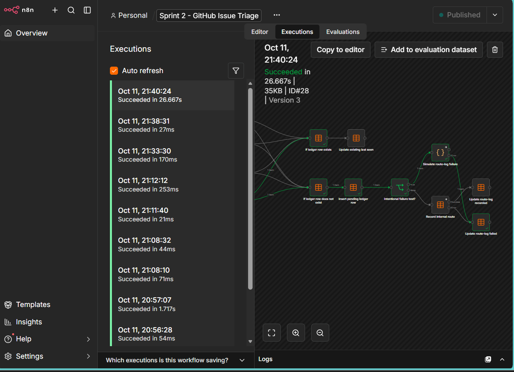

## Final table state
The ledger shows four `recorded` rows and one `failed` row with its `error_note`. The route log has four rows (bug-triage, feature-requests, general-triage, support) and none for the failed issue.

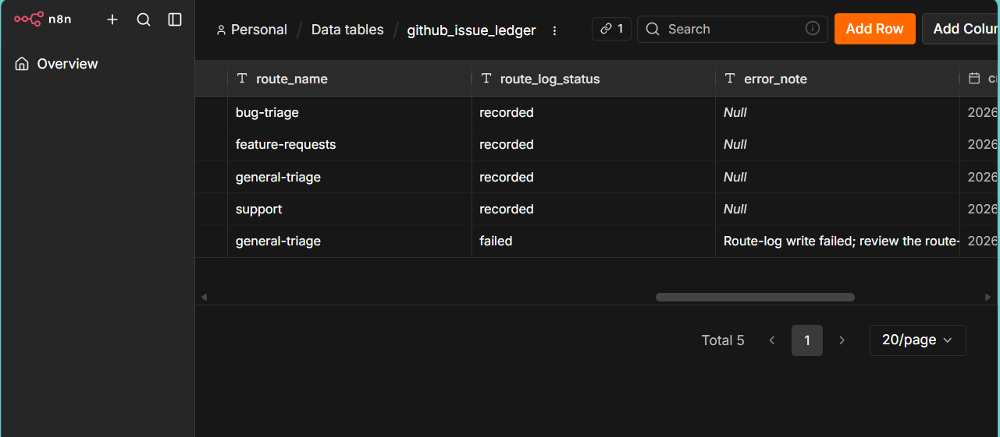
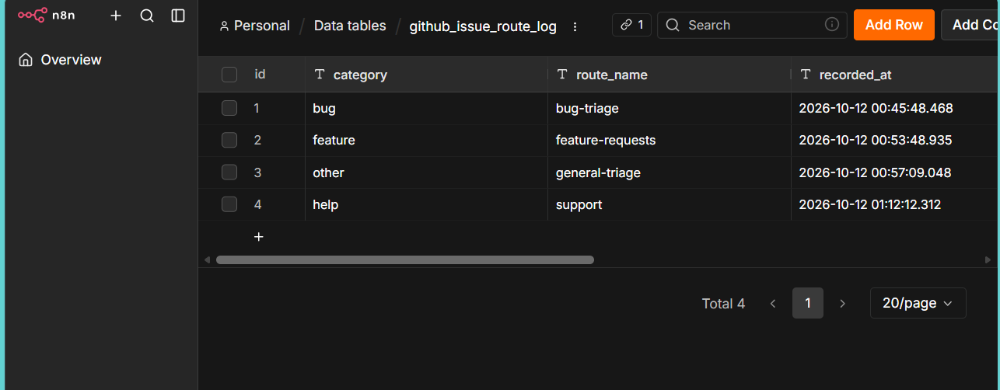
